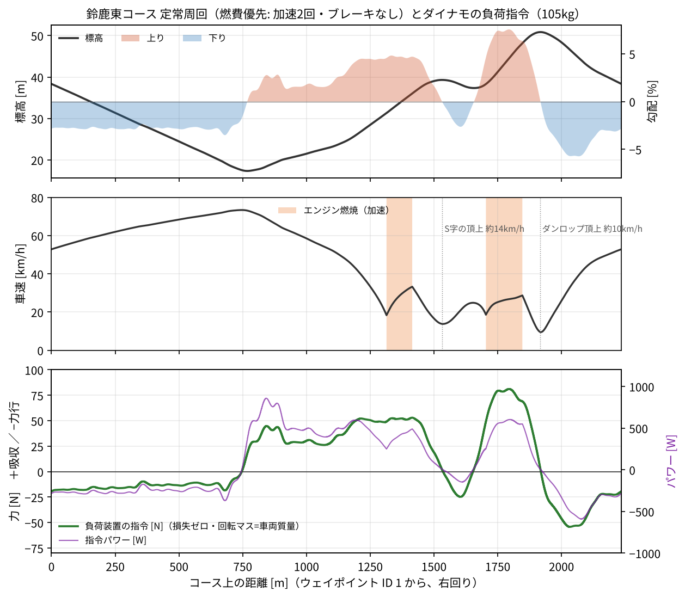

# Chibi-T 負荷付きシャシーダイナモ

ちびTインターナショナルの Chibi-T（Honda エコ マイレッジ チャレンジ、鈴鹿大会 CN グループⅣ）用に、いまの加速度型シャシーダイナモ（回転マス 105 kg 相当）へ負荷装置を加えるための設計資料。**鈴鹿東コースの登り・下りを含む 1 周を台上で再現し、エンジンの出力と燃料消費を測れる**ようにすることを目指す。

状態: 要件定義の草案（2026-11-01）。製作はまだ始めていない。

## 要点

| 項目 | 内容 |
| --- | --- |
| 再現する走り方 | 燃費優先（加速は 1 周 2 回、ブレーキなし）。速度 9.5〜73.4 km/h、1 周 約 226 秒 |
| 負荷装置に要る力 | 吸収 +81 N（ダンロップの登り）〜力行 −54 N（最終コーナーへの下り）、パワー +858〜−590 W |
| 負荷装置の方式 | **吸収と力行の両方ができ、速度 0 でもトルクを保てるモーター**（1 周の 46% は力行）。渦電流ブレーキだけでは再現できない |
| 機械 | ローラを φ80 → **φ200〜300**（推奨 φ250）にして損失を下げる（現行は 30 km/h で 44 N、実走の約 10 倍）。回転マスは 105 kg 相当のまま |
| 計測 | ローラのエンコーダー（1,000 P/R 以上）と、負荷装置の反力のロードセル（±1 N） |
| 制御 | 走行抵抗＋勾配の力制御、定速度、定力、惰行試験。ロガーへ GPS を模擬して送る HIL |
| 概算予算 | 最小構成 約 38 万円 ／ 推奨構成 約 115 万円（予備費 15% 込み） |
| エンジン（実走推定） | 最大 0.95 PS（0.70 kW）@ 3,600 rpm、最大トルク 2.2 N·m @ 2,600 rpm（全開） |



## 資料

| ファイル | 内容 |
| --- | --- |
| [docs/requirements.md](docs/requirements.md) | **要件定義**: 目的、前提、負荷の要件、現行の評価、機械・電気・計測・制御・安全の要件（ID 付き）、校正・受け入れ試験、未確定事項、部品例、概算予算 |
| [docs/analysis_notes.md](docs/analysis_notes.md) | 要件の根拠になった解析（実走の出力推定、現行ダイナモの損失、鈴鹿の勾配、1 周の負荷） |
| [docs/references.md](docs/references.md) | 参考資料（AkiRacing の加速度型ダイナモの要約、FC デザイン、戦略書、鈴鹿） |
| [results/LOG0672_出力トルク推定.xlsx](results/LOG0672_出力トルク推定.xlsx) | 実走ログからの出力・トルク推定を数式でたどれる Excel ブック |

## 構成

```
analysis/   解析スクリプト（Python）
config/     戦略パラメータの写し（UNOR4_Chibi-T_EFI の tools/strategy/suzuka_2027.json から）
data/
  logs/     元のログ（LOG0672: 2026 全国大会 決勝・もてぎ、LOG0650: 現行ダイナモ）
  course/   鈴鹿東コースのウェイポイント（緯度・経度・標高）
  derived/  スクリプトの出力（出力カーブ、損失、勾配、1 周の負荷プロファイル）
docs/       要件定義・解析ノート・参考資料
figures/    図
results/    Excel ブック
```

データの列の説明は [data/README.md](data/README.md)。

## 再現のしかた

Python 3.10 以降。

```bash
pip install -r requirements.txt

# 実走ログ → 全開の出力・トルクカーブ
python analysis/road_power_estimate.py data/logs/LOG0672_燃料消費量燃費補正済.CSV \
    --out data/derived/power_curve_LOG0672.csv --fig figures/power_torque_curve_LOG0672.png

# 現行ダイナモのログ → ダイナモ自体の損失と出力
python analysis/dyno_log_analysis.py data/logs/LOG0650.CSV --out data/derived/dyno_LOG0650.json

# 鈴鹿の勾配 → 燃費優先の 1 周 → 負荷プロファイル
python analysis/suzuka_lap_load.py                                          # 乾、損失ゼロ
python analysis/suzuka_lap_load.py --rain                                   # 雨
python analysis/suzuka_lap_load.py --loss data/derived/dyno_LOG0650.json    # 現行 φ80 の損失を差し引く
```

質量・駆動効率・走行抵抗などは引数で変えられる（`--help`）。戦略ファイルが更新されたら、`config/suzuka_2027_strategy_params.json` を写し直す。

## 関連

- [todateman/UNOR4_Chibi-T_EFI](https://github.com/todateman/UNOR4_Chibi-T_EFI): ECU と走り方の戦略（`document/suzuka_strategy_2027.md`）
