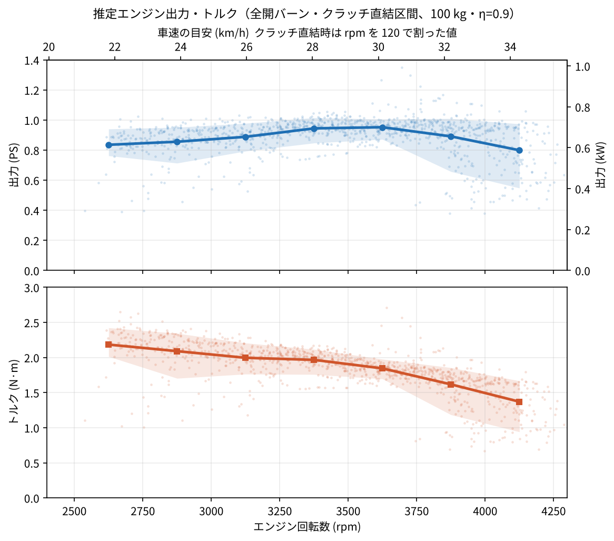
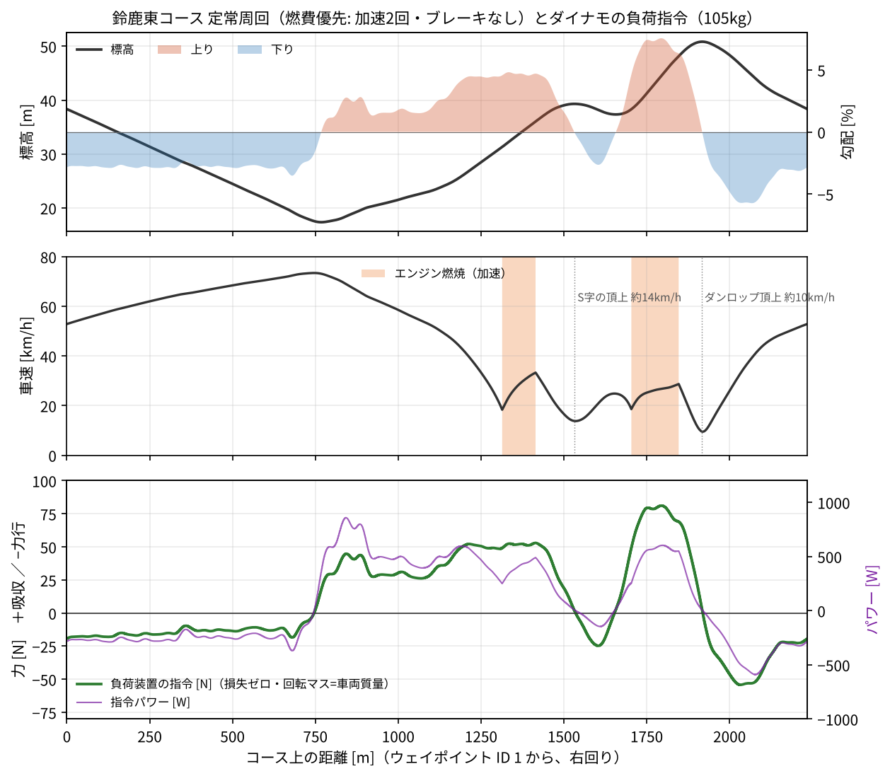

# 解析ノート（設計の根拠になった計算）

要件定義（[requirements.md](requirements.md)）の数値の出どころをまとめる。どの結果もスクリプトで再現できる（[README](../README.md#再現のしかた)）。

---

## 1. 実走ログからのエンジン出力の推定（LOG0672）

2026 年全国大会 決勝（もてぎ）の走行ログから、全開で加速している区間（バーン）の運動方程式でエンジン出力を推定した。スクリプトは [`analysis/road_power_estimate.py`](../analysis/road_power_estimate.py)。Excel で計算過程をたどれるブックが [`results/LOG0672_出力トルク推定.xlsx`](../results/LOG0672_出力トルク推定.xlsx)。

### 方法

```
F  = m·a + m·g·勾配 + Crr·m·g + ½·ρ·CdA·v²    （駆動力）
Pw = F·v                                     （車輪出力）
Pe = Pw / η                                  （エンジン出力）
T  = Pe / (2π·rpm/60)                        （エンジントルク）
```

| 項目 | 値・方法 |
| --- | --- |
| 質量 m | 100 kg（車体 47 kg ＋ ドライバー 53 kg）。戦略ファイルの 105 kg とは別 |
| 加速度 a | 0.1 秒刻みに整形した車速を、Savitzky–Golay（15 点 = 1.5 秒、2 次）で微分。GNSS の車速は約 0.4 秒ごとの階段状 |
| 勾配 | 2〜7 周の標高を周回内位置 10 m ごとに集計 → 周平均を引いた偏差の中央値 → 円周状にガウス平滑（σ = 50 m）→ 中央差分。高低差は約 ±1.5 m |
| Crr・CdA | エンジン停止中の惰行区間（勾配補正後）の中央値回帰で Crr = 0.00215、CdA = 0.071 m²（30 km/h で約 5 N） |
| 空気密度 ρ | ログの気圧・気温・湿度から 1.153 kg/m³ |
| 駆動効率 η | 0.90（仮定） |
| 採用点 | 回転数 > 500 のバーンのうち、開始・終了から 1 秒以上離れ、rpm/(km/h) が 112〜128（クラッチ直結）、2,400〜4,300 rpm の 1,070 点 |
| スロットル | スロットルバルブのないエンジンなので、バーン中は常に全開 → 全開の出力として読める |

### 結果

| 回転数 [rpm] | 車速の目安 [km/h] | 出力 [PS] | 出力 [kW] | トルク [N·m] |
| --- | --- | --- | --- | --- |
| 2,625 | 21.8 | 0.84 | 0.61 | **2.18** |
| 2,875 | 23.9 | 0.86 | 0.63 | 2.09 |
| 3,125 | 26.0 | 0.89 | 0.65 | 2.00 |
| 3,375 | 28.0 | 0.94 | 0.69 | 1.97 |
| 3,625 | 30.1 | **0.95** | **0.70** | 1.84 |
| 3,875 | 32.2 | 0.89 | 0.66 | 1.62 |
| 4,125 | 34.3 | 0.80 | 0.59 | 1.37 |



- 車速の目安は rpm ÷ 120.3（クラッチ直結時の中央値）。
- 熱効率の確認: 推定出力の積分と燃料（14.4 ml、32 kJ/ml）から約 18%。小型エンジンとして妥当。
- 感度: 走行抵抗の係数・平滑化の窓幅・η（0.85〜0.95）を振って ±5〜6%。絶対値は ±10% 程度の見積もり。
- 2,500 rpm 未満はクラッチ滑りのため推定できない。4,000 rpm 超はエンジンを止める瞬間が混ざり、低めに出ている可能性がある。

---

## 2. 現行ダイナモのログ（LOG0650）

AkiRacing の構成の加速度型（φ80 ローラ、3 倍増速のフライホイール、回転マス 105 kg 相当）で、0→約 40 km/h の全開加速を 3〜4 回行ったログ。スクリプトは [`analysis/dyno_log_analysis.py`](../analysis/dyno_log_analysis.py)、結果は [`data/derived/dyno_LOG0650.json`](../data/derived/dyno_LOG0650.json)。

### ダイナモ自体の損失

エンジン停止中の惰行（886 点、7.2〜29.4 km/h）の減速を、105 kg として 2 次式で当てはめた。

```
F_loss = 15.58 + 1.501·v + 0.2309·v²   [N]（v は m/s）
```

| 車速 | 損失 | 備考 |
| --- | --- | --- |
| 10 km/h | 21.5 N | |
| 20 km/h | 31.0 N | |
| 30 km/h | 44.1 N | 実走の走行抵抗（約 4〜5 N）の約 10 倍、勾配 3〜4% 相当 |
| 40 km/h | 60.8 N | 外挿 |
| 75 km/h | 147 N | 外挿（参考値） |

主な原因は小径ローラ（φ80）でのタイヤの転がり損失と考えられる。戦略ファイルの `burn.drum_decel` 0.5 m/s²（≒ 52 N）とも同程度。

### 出力の推定と実走との差

| 回転数 [rpm] | 損失込み [PS] | 慣性だけ [PS] | 実走推定 [PS] |
| --- | --- | --- | --- |
| 2,625 | 1.13 | 0.84 | 0.84 |
| 3,125 | 0.96 | 0.54 | 0.89 |
| 3,625 | 1.09 | 0.53 | 0.95 |
| 4,125 | 1.27 | 0.52 | 0.80 |
| 4,625 | 1.29 | 0.34 | — |

- 損失を足すかどうかで値が 2 倍近く変わり、実走推定はその間にある。30 km/h では損失分だけで約 0.5 PS。
- 気温（30.8 °C と 22 °C）や回転域も違うので、どちらが正しいかはこのデータでは決められない。
- **設計への示唆:** 負荷装置の反力をロードセルで直接測り（R-S-02）、ダイナモの損失を小さくする（R-M-02, 06）。
- 台上の rpm/(km/h) は 119.3（実走 120.3 に対し −0.8%）。タイヤとローラの滑りはほぼない。

---

## 3. 鈴鹿東コースの勾配

[`data/course/suzuka_east_waypoint.csv`](../data/course/suzuka_east_waypoint.csv)（300 点）を閉じた線として 1 m ごとに補間し、円周状に σ = 15 m でガウス平滑して勾配を求めた。結果は [`data/derived/suzuka_east_grade_1m.csv`](../data/derived/suzuka_east_grade_1m.csv)。

| 項目 | 値 |
| --- | --- |
| 1 周 | 2,234 m（右回り、ウェイポイント ID 1 から） |
| 標高 | 17.2〜51.0 m（高低差約 34 m） |
| 最大上り | +7.5%（1,790 m 付近、ダンロップへの登り）。σ を 10〜25 m に変えても 7.4〜7.8% |
| 最大下り | −5.7%（2,070 m 付近、最終コーナーへ） |
| 上り区間 | 775〜1,522 m（約 750 m、平均 2.9%、最大 4.8%、S 字）、1,665〜1,913 m（約 250 m、平均 5.4%、最大 7.5%） |
| 下り区間 | メインストレート 約 760 m・平均 −2.8%、最終区間 約 310 m・平均 −4.0% |

---

## 4. 燃費優先の走り方での 1 周と負荷プロファイル

走り方は UNOR4_Chibi-T_EFI の戦略書（`document/suzuka_strategy_2027.md`）と戦略ファイル（`tools/strategy/suzuka_2027.json`、コミット `3ad6982`）による。必要な項目は [`config/suzuka_2027_strategy_params.json`](../config/suzuka_2027_strategy_params.json) に写した。

- 加速は 1 周 2 回（S 字とダンロップの登り）。登りで 21 km/h まで落ちたら始動（遅れ 1.6 秒）、頂上の止め時（S 字 1,533 m を 14 km/h、ダンロップ 1,916 m を 10 km/h）で止める（遅れ 0.5 秒）。
- 乾いた路面はブレーキなし（下りの底で約 73 km/h）。雨は 55 km/h に抑える。
- 戦略シミュレータとは独立に組み直した近似の計算（[`analysis/suzuka_lap_load.py`](../analysis/suzuka_lap_load.py)）。

### 再現した定常周回（乾いた路面）

| 項目 | 計算 | 戦略書 |
| --- | --- | --- |
| 1 周 | 225.5 秒 | 222 秒（3:42） |
| 速度 | 9.5〜73.4 km/h | 11〜73 km/h |
| 加速 1（S 字） | 1,314〜1,415 m、18.3→33.3 km/h、13.5 秒 | 1,314〜1,416 m、約 33 km/h |
| 加速 2（ダンロップ） | 1,704〜1,847 m、18.6→28.7 km/h、20.3 秒 | 1,703〜1,847 m、29 km/h |
| 頂上の速度 | 13.8 / 9.6 km/h | 約 15 / 11 km/h |
| 燃料（ECU 積算の尺度） | 2.36 ml/周 | 約 2.46 ml/周 |

### 負荷装置の指令（F_cmd = M·g·(Crr + 勾配) + M·k·v² + (M − M_eq)·a − F_loss）

| 条件 | 力 [N] | パワー [W] | 吸収の時間 | 吸収 / 力行 [kJ/周] | ファイル |
| --- | --- | --- | --- | --- | --- |
| 乾、損失ゼロ、M_eq = M | −54〜+81 | −590〜+858 | 54% | 44 / 23 | [`suzuka_lap_load_dry.csv`](../data/derived/suzuka_lap_load_dry.csv) |
| 雨、損失ゼロ | −53〜+83 | −576〜+619 | 55% | 43 / 26 | [`suzuka_lap_load_rain.csv`](../data/derived/suzuka_lap_load_rain.csv) |
| 乾、現行 φ80 の損失を差引（外挿を含む） | −158〜+42 | −3,175〜+309 | 28% | 8 / 168 | [`suzuka_lap_load_dry_with_loss.csv`](../data/derived/suzuka_lap_load_dry_with_loss.csv) |



- 雨の条件では、S 字の加速が 1,169 m からと早く始まり（下りを 55 km/h に抑えるため）、燃料は 3.38 ml/周、1 周は 245 秒。
- 指令の変化は最大 33 N/s と遅い。燃焼中の駆動力は 72〜98 N（10 km/h での坂道発進では約 130 N）。
- **吸収しかできない負荷装置では 1 周の約半分を再現できない**。現行の φ80 ダイナモでは損失が大きすぎ、1 周の約 3/4 が力行になる。
