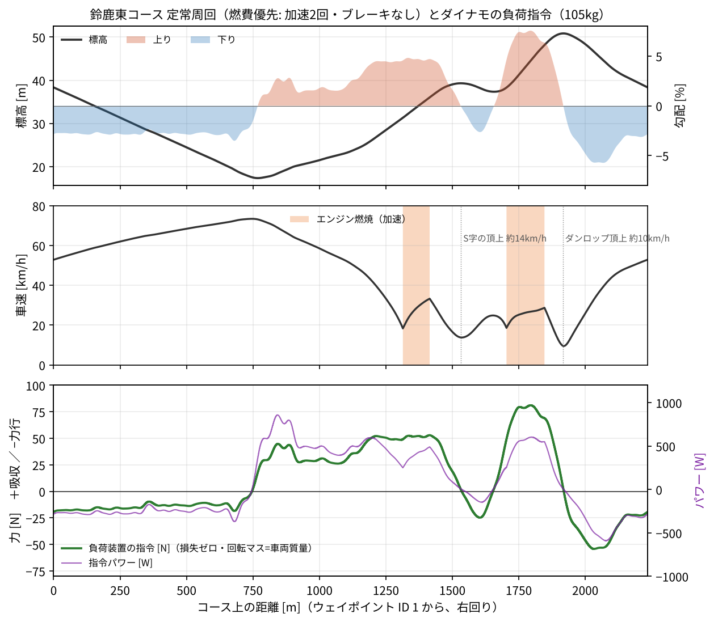

# 負荷付きシャシーダイナモ 要件定義（鈴鹿東コース再現・エンジン出力計測）

Chibi-T（Honda エコ マイレッジ チャレンジ、鈴鹿大会 CN グループⅣ）用に、加速度型ダイナモ（回転マス 105 kg 相当）へ負荷装置を加え、**鈴鹿東コースの登り・下りを含む 1 周を台上で再現し、エンジンの出力・燃料消費を計測できる**ようにするための要件をまとめる。

- 作成: 2026-11-01（草案）
- 走り方: [`document/suzuka_strategy_2027.md`](https://github.com/todateman/UNOR4_Chibi-T_EFI/blob/3ad6982eedc13334630512852d879357dced2a59/document/suzuka_strategy_2027.md)、パラメータは [`tools/strategy/suzuka_2027.json`](https://github.com/todateman/UNOR4_Chibi-T_EFI/blob/3ad6982eedc13334630512852d879357dced2a59/tools/strategy/suzuka_2027.json)（コミット `3ad6982`）
- コース: [`data/course/suzuka_east_waypoint.csv`](../data/course/suzuka_east_waypoint.csv)（300 点、1 周 2,234 m、右回り）
- 現行ダイナモ: AkiRacing「加速度型シャーシダイナモの製作」（2017）と同じ構成。ローラ φ80（ミスミ ROLJT80-25-200）、チェーン #25 の 75T/25T で 3 倍に増速、フライホイール。ログは LOG0650 と LOG0645
- 実走: LOG0672（2026 年全国大会 決勝、もてぎ）

数値はすべて、上の走り方を計算で再現した 1 周（[付録 A](#付録-a-計算条件)）から出した。要件の番号は `R-<分類>-<番号>`。**必須**は満たさないと目的を果たせないもの、**推奨**は精度や使い勝手のためのもの。

---

## 1. 目的と範囲

| 目的 | 内容 |
| --- | --- |
| G1 コースの再現 | 鈴鹿東コースの勾配（最大 +7.5%・−5.7%）と走行抵抗を、車両の位置と速度に応じて台上で与える。燃費優先の走り方（1 周 2 回の加速、ブレーキなし）をそのまま走れる |
| G2 出力の計測 | エンジンの全開出力・トルクを、回転数ごとに一定回転（定常）と加速（過渡）の両方で測る。実走推定（0.95 PS @3,600 rpm、2.2 N·m @2,600 rpm）と ±5% で照合できる精度 |
| G3 EFI の開発 | 登りの負荷（49〜81 N、2,200〜4,000 rpm）で燃料・点火マップを合わせ、燃料消費率（`fuel_ml_s`）と加速力（`accel_real`）の表を取り直す |
| G4 走り方の検証 | 頂上の止め時、21 km/h での再始動、登りでの始動失敗・坂道発進を台上で試す。ロガーのファームを含めて確かめる（HIL） |

範囲外: 二輪車、雨の路面での滑り（タイヤとローラの摩擦は乾いた路面と別物）、コーナーでの横力。

---

## 2. 前提（再現する走り方）

| 項目 | 値 | 出典 |
| --- | --- | --- |
| 車両＋ドライバー質量 M | 105 kg | `vehicle.mass_kg`（加速度の計算は 100 kg で行ったが、戦略の値に合わせる） |
| 走行抵抗 | 減速度 = g·(Crr + 勾配) + k·v²、Crr = 0.00107、k = 0.000395 /m（乾）。雨は Crr = 0.00281、k = 0.000309 | `vehicle`、2024 年鈴鹿 LOG0277 の惰行から推定 |
| 加速の合図 | 登りで 21 km/h まで落ちたら始動。ボタンを押してから動き出すまで 1.6 秒 | `guard_kmh`、`restart.delay_s` |
| 止める合図 | 頂上の止め時（S 字の頂上 1,533 m を 14 km/h、ダンロップの頂上 1,916 m を 10 km/h で越えられる速度で止める）。止まるまでの遅れ 0.5 秒 | `crest_cut`、`burn.cut_lag_s` |
| 下り | 乾いた路面はブレーキなし（下りの底 760 m で約 73 km/h）。雨は 55 km/h に抑える | `v_max_zones_m` |
| 周回 | 8 周、規定 2,536.7 秒。計画は乾いた路面 30:08、1 周約 3:42 | 戦略書 |

### 2.1 再現した定常周回

| 項目 | 計算値 | 戦略書 |
| --- | --- | --- |
| 1 周 | 226 秒 | 222 秒（3:42） |
| 速度 | 9.6〜73.4 km/h | 11〜73 km/h |
| 加速 1（S 字） | 1,314〜1,415 m、18.4→33.3 km/h、13.5 秒、勾配平均 4.7% | 1,314〜1,416 m、約 33 km/h で止まる |
| 加速 2（ダンロップ） | 1,704〜1,847 m、18.6→28.7 km/h、20.3 秒、勾配平均 6.8%（最大 7.5%） | 1,703〜1,847 m、29 km/h で止まる |
| 頂上の速度 | S 字 13.7 km/h、ダンロップ 9.7 km/h | 約 15 km/h、約 11 km/h |
| 燃料（ECU 積算の尺度） | 2.36 ml/周 | 19.7 ml/8 周（約 2.46 ml/周） |



---

## 3. 負荷の要件（計算結果）

負荷装置への指令（回転マス = 車両質量、ダイナモの損失はゼロとした値）:

```
F_cmd = M·g·(Crr + sinθ(s)) + M·k·v²
```

| 区間 | 距離 m | 速度 km/h | 指令の力 N | 指令パワー W | 時間 s |
| --- | --- | --- | --- | --- | --- |
| メインストレートの下り | 0〜740 | 53〜73 | −19〜−3 | −370〜−64 | 42 |
| 1・2 コーナー〜S 字の入口 | 740〜1,150 | 48〜73 | −3〜+45 | −56〜**+859** | 24 |
| S 字の登り（加速 1） | 1,150〜1,533 | 14〜48 | +1〜+53 | +6〜+597 | 52 |
| 逆バンクへの下り | 1,533〜1,652 | 14〜25 | −25〜+1 | −147〜+3 | 23 |
| ダンロップの登り（加速 2） | 1,652〜1,916 | 10〜29 | 0〜**+81** | 0〜+604 | 44 |
| 頂上〜最終コーナーの下り | 1,916〜2,234 | 10〜53 | **−54**〜+4 | **−590**〜+9 | 40 |

| まとめ | 値 |
| --- | --- |
| 吸収（ブレーキ側）の最大 | **+81 N / +859 W**（パワーの最大は 1・2 コーナーの先の高速の登り） |
| 力行（押す側）の最大 | **−54 N / −590 W**（最終コーナーへの下り） |
| 吸収している時間 | 1 周の 54%（残りの 46% は押す側） |
| 1 周のエネルギー | 吸収 44 kJ、力行 23 kJ（正味 21 kJ を吸収） |
| 8 周連続 | 吸収 353 kJ、平均 195 W |
| 指令の変化の速さ | 最大 33 N/s（勾配は 15 m 程度で平滑） |
| 燃焼中の運転点 | 18〜33 km/h（2,200〜4,000 rpm）、負荷 49〜81 N、正味の加速度 0.04〜0.44 m/s² |
| 駆動力（全開） | 72〜98 N（10 km/h での坂道発進では約 130 N） |
| 停止保持 | 7.5% の登りで 78 N を、速度 0 のまま保つ |

**結論:** 吸収しかできない負荷装置（渦電流・パウダーブレーキ）では、1 周の約半分を再現できない。**吸収と力行の両方ができ、速度 0 でもトルクを保てる負荷装置（モーター）が必須**。

---

## 4. 現行ダイナモの評価

| 項目 | 現状 | 問題 |
| --- | --- | --- |
| 回転マス | 105 kg 相当（`burn.inertia_kg`） | 車両質量と同じで良い。**このまま使う** |
| ダイナモ自体の損失 | LOG0650 の惰行から 15.6 + 1.5v + 0.23v² N（20 km/h で 31 N、30 km/h で 44 N）。`drum_decel` は 0.5 m/s²（≒ 52 N） | 実走の走行抵抗（30 km/h で約 4 N）の約 10 倍で、勾配 3〜4% に相当する。73 km/h まで外挿すると約 140 N になり、損失を打ち消すのに約 3 kW の力行が要る（外挿なので参考値） |
| ローラ | φ80 mm | 小径なのでタイヤの転がり損失が大きい。80 km/h でローラが 5,300 rpm、フライホイールは 3 倍の約 16,000 rpm になる。**この速度で回すのは危険** |
| 速度の計測 | ロガーの速度（0.2 秒ごとの階段状） | 登りの正味の加速度は 0.04〜0.2 m/s² しかない。1 N（≒0.01 m/s²）の分解能が要る |
| 力の計測 | なし（慣性と速度から計算） | 出力が損失の見積もり次第になる（実走推定 0.85〜0.95 PS に対し、台上の計算は 1.0〜1.3 PS） |

---

## 5. 機械設計・制作の要件

| ID | 区分 | 要件 | 根拠・備考 |
| --- | --- | --- | --- |
| R-M-01 | 必須 | 速度範囲 0〜80 km/h（連続 75 km/h） | 下りの底で 73.4 km/h |
| R-M-02 | 必須 | ローラ径 **φ200〜300 mm**（推奨 φ250）。ミスミの寸法指定品で可 | 損失の低減。φ250 なら 80 km/h で 1,700 rpm |
| R-M-03 | 必須 | ローラの幅はタイヤ幅＋左右の振れ分（目安 100 mm 以上）。表面は鋼で、必要なら軽いローレットを付ける。振れは 0.05 mm 以下 | 滑りと振動の抑制 |
| R-M-04 | 必須 | 回転マスは車両質量と同じ 105 kg 相当（ローラ軸で I = M·r²、φ250 なら 1.64 kg·m²）。フライホイールの増速比 n なら、フライホイールは I/n² | 加速の慣性を機械で再現し、制御から微分の項をなくす |
| R-M-05 | 推奨 | 回転マスを ±10 kg 相当の範囲で、板の追加で変えられる | ドライバーの体重差・雨の装備 |
| R-M-06 | 必須 | ダイナモ自体の損失 **30 km/h で 10 N 以下、75 km/h で 25 N 以下**（暖機後の惰行試験で確認） | 力行の容量を 1 kW 級に収めるため（R-E-02） |
| R-M-07 | 必須 | 軸受は低摩擦（シールは非接触型か軽接触型）。ローラ・フライホイール・負荷装置の軸の心出しをする | R-M-06 |
| R-M-08 | 必須 | 負荷装置は揺動支持（左右の軸受でステーターを支え、トルクアームとロードセルで反力を取る） | R-S-02 |
| R-M-09 | 必須 | ローラから負荷装置までは歯付きベルト（HTD・GT など）で 2〜4 倍に増速する。バックラッシュがなく、張りを調整できること | 負荷装置の小型化。チェーンは振動と損失が大きい |
| R-M-10 | 必須 | 車両の前後拘束: 前後方向に ±200 N、左右にも動かない。力行時にはローラが車両を前へ押すので、両方向で止める | 最大の指令 +81/−54 N と坂道発進 130 N |
| R-M-11 | 必須 | 駆動輪の荷重を確保し、滑りは 1% 以下（台上の回転数/車速比を実走の 120.3 rpm/(km/h) と比べる） | LOG0650 は 119.3（−0.8%） |
| R-M-12 | 必須 | フレームの安全率は 3 以上（現行は FEM で 5.7）。持ち運べること（キャスター付き） | AkiRacing の構成を踏襲 |
| R-M-13 | 必須 | 回転部（ローラ・フライホイール・ベルト）を覆うガード。フライホイールの破裂に耐える囲い | 80 km/h で回転部の運動エネルギーは約 26 kJ |
| R-M-14 | 推奨 | エンジン冷却用の送風（車速に連動）と排気の屋外への排出 | 実走のエンジン温度 81〜97 °C に合わせる |
| R-M-15 | 推奨 | 燃料タンクを電子天秤に載せられる（重量で燃料を量る） | ECU 積算と実際の消費の換算係数（もてぎで 1.438） |

### 5.1 ローラ径ごとの目安（M = 105 kg）

| ローラ径 | 80 km/h の回転数 | 吸収 81 N のトルク | 力行 54 N のトルク | 駆動力 130 N のトルク | 回転マス I |
| --- | --- | --- | --- | --- | --- |
| φ80（現行） | 5,305 rpm | 3.2 N·m | 2.2 N·m | 5.2 N·m | 0.168 kg·m² |
| φ200 | 2,122 rpm | 8.1 N·m | 5.4 N·m | 13.0 N·m | 1.050 kg·m² |
| **φ250** | **1,698 rpm** | **10.1 N·m** | **6.8 N·m** | **16.3 N·m** | **1.641 kg·m²** |
| φ300 | 1,415 rpm | 12.2 N·m | 8.1 N·m | 19.5 N·m | 2.362 kg·m² |

---

## 6. 負荷装置・電気の要件

| ID | 区分 | 要件 | 根拠・備考 |
| --- | --- | --- | --- |
| R-E-01 | 必須 | **吸収と力行の両方ができる負荷装置**: 永久磁石同期モーター（PMSM/BLDC）＋インバーター（FOC、電流制御） | 1 周の 46% は力行（§3） |
| R-E-02 | 必須 | ローラ表面の力で **±100 N**、パワーで **±1.5 kW（30 秒）、連続 ±1 kW**。損失の打ち消し分（R-M-06 の上限 25 N × 20.8 m/s ≒ 0.5 kW）を含む。メインストレートの下り（42 秒）は、指令 −0.37 kW ＋ 損失分で約 0.9 kW の力行が続く | 指令 +81/−54 N、+859/−590 W |
| R-E-03 | 必須 | **センサー付き FOC**（エンコーダーかホール素子）。速度 0 でトルクを保てる | 坂道発進の試験で 78 N を保持 |
| R-E-04 | 必須 | 例: φ250 ローラで 1:3 に増速するなら、モーターは 4〜5 N·m（ピーク）・5,100 rpm（80 km/h）・1〜1.5 kW 級 | §5.1 |
| R-E-05 | 必須 | 直流母線は 48 V のバッテリー（回生した電力を次の力行に回す）。ブレーキ抵抗は 1 kW 連続（バッテリー満充電時と故障時） | 1 周で吸収 44 kJ・力行 23 kJ。正味 21 kJ/周（約 95 W）を逃がす |
| R-E-06 | 必須 | インバーターの電流ループは 10 kHz 以上。トルク指令は 1 kHz 以上で受け付ける（CAN か UART） | R-C-03 |
| R-E-07 | 必須 | エンジンの点火を止める信号を、ダイナモの制御器から ECU へ出す（非常停止と連動） | R-F-02 |
| R-E-08 | 推奨 | インバーターは VESC 系など、電流指令・速度・温度を読める市販品 | 開発の手間を減らす |

---

## 7. 計測の要件

| ID | 区分 | 要件 | 根拠・備考 |
| --- | --- | --- | --- |
| R-S-01 | 必須 | ローラの回転はエンコーダー（1,000 パルス/回転以上）で測る。パルスの周期を測り、速度の分解能は 0.01 km/h | 正味の加速度 0.04 m/s² を 0.01 m/s² 単位で見る |
| R-S-02 | 必須 | 負荷装置の反力をロードセルで測る: ローラ表面換算で ±200 N、精度 ±1 N（≒ 勾配 0.1%）、サンプリング 1 kHz | 出力を損失の推定に頼らず求める |
| R-S-03 | 必須 | 車輪の駆動力 = ロードセルの力 ＋ 回転マス × 加速度 ＋ ダイナモの損失（R-V-03 の惰行試験で更新） | |
| R-S-04 | 必須 | 走行距離 s はエンコーダーから積算し、1 周（2,234 m）でコース上の位置に戻す | R-C-02 |
| R-S-05 | 必須 | ECU・ロガーと時刻をそろえる（同期パルスか共通の時刻）。ダイナモは 100 Hz 以上、ECU のログ（10 Hz）と結合する | 回転数・噴射・点火・燃圧と力を同じ時間軸で見る |
| R-S-06 | 必須 | 記録項目: 時刻、ローラ速度、加速度、距離、コース上の位置、指令の力、ロードセルの力、モーターの電流・速度・温度、母線電圧・電流、モード | |
| R-S-07 | 推奨 | 燃料の重量（電子天秤、0.01 g）、吸気温度・気圧・湿度（ロガーと同じセンサー）、エンジン温度 | 補正係数と大気補正 |
| R-S-08 | 推奨 | 補正: 出力は気圧・気温で標準状態に補正して比べられるようにする（実走推定のブックと同じ空気密度の式） | 実走との照合 |

---

## 8. 制御の要件

### 8.1 制御則

```
F_cmd(t) = M·g·(Crr + sinθ(s)) + M·k·v²          … 走行抵抗と勾配（コースの再現）
         + (M − M_eq)·a                           … 回転マスと車両質量の差（同じなら 0）
         − F_loss(v)                              … ダイナモ自体の損失（惰行試験で更新）
```

- `s`: エンコーダーで積算した距離、`θ(s)`: コースの勾配表（1 m ごと、15 m 程度で平滑）、`v`: ローラの速度、`a`: 加速度（R-M-04 で M_eq = M にして、この項を使わないのが基本）。
- 車両の質量・Crr・k・勾配表は、戦略の JSON（`vehicle`、`suzuka_waypoint.csv`）からそのまま読み込む。乾いた路面と雨（`variants.rain`）を切り替えられる。

### 8.2 要件

| ID | 区分 | 要件 | 根拠・備考 |
| --- | --- | --- | --- |
| R-C-01 | 必須 | 運転モード: ①加速度型（負荷 0、現行と同じ測り方）②定速度 ③定力（一定の勾配）④コースの再現（8.1 の式）⑤惰行試験（損失の測定）⑥力行（エンジン停止でモーターが回す） | ①は `accel_drum`・`fuel_ml_s` を取った LOG0645 と同じ条件で比べるため |
| R-C-02 | 必須 | コースの再現: 勾配表と走行抵抗の係数をファイルから読み込む。開始位置（発進 110 m、計測ライン 112 m）と周回数を指定できる | 1 周目の発進（ピットレーンの 2.8% の下り）から 8 周を通しで再現する |
| R-C-03 | 必須 | 力の制御: インバーターの電流指令をフィードフォワード（トルク定数から）にし、ロードセルの値でフィードバック（PI）。帯域 5〜10 Hz、定常偏差 ±1 N | 指令の変化は最大 33 N/s と遅い。単気筒の爆発周期（18〜33 Hz）とは干渉させない |
| R-C-04 | 必須 | 定速度モード: 速度 PI 制御、目標 ±0.1 km/h。2,200〜4,300 rpm（18〜36 km/h）の各点で全開・定常の出力を測れる | 実走推定のカーブとの照合、EFI のマップ合わせ |
| R-C-05 | 必須 | 制御周期: 力・速度のループは 1 kHz、コースの位置・勾配の更新は 100 Hz 以上 | |
| R-C-06 | 必須 | **ロガーへの GPS の模擬（HIL）**: コース上の位置から緯度・経度・速度を作り、NMEA（RMC・GGA）でロガーの GNSS の UART へ送る | ロガーの頂上の止め時・21 km/h の合図・周回のカウントを、台上でそのまま試す |
| R-C-07 | 必須 | 再始動の遅れ（1.6 秒）や始動の失敗の間も、エンジンの状態に関係なく勾配の負荷を与え続ける（減速を再現する） | 登りで止まる危険の検証（ダンロップの登りで 21 km/h から約 8 秒で止まる） |
| R-C-08 | 必須 | 坂道発進の試験: 速度 0 で勾配の力（7.5% で 78 N）を保持し、エンジンの発進を受け止める | 2024 年の、登りで回転は上がるのに車速が 0 になる現象の再現 |
| R-C-09 | 推奨 | 勾配表の差し替え（もてぎ・他コース）、走行抵抗の感度（±20%）、加速力の感度を 1 つの設定で振れる | 戦略書の感度表と同じ条件 |
| R-C-10 | 推奨 | 惰行試験（モード⑤）を自動化し、F_loss(v) = a + b·v + c·v² を毎回更新して保存する | R-V-03 |

---

## 9. 安全の要件

| ID | 区分 | 要件 | 根拠・備考 |
| --- | --- | --- | --- |
| R-F-01 | 必須 | 過速度の保護: 85 km/h で力行を止め、制動へ切り替える | R-M-01 |
| R-F-02 | 必須 | 非常停止: ボタン 1 つで、①エンジンの点火を止める（R-E-07）②負荷装置で最大の制動 ③ブレーキ抵抗へ逃がす。80 km/h から 20 秒以内に止める（26 kJ ÷ 1.5 kW ≒ 17 秒） | 回転部のエネルギー |
| R-F-03 | 必須 | 監視（ウォッチドッグ）: 制御器・インバーター・ロードセルの通信が途切れたら、トルク 0 にして、点火を止める | |
| R-F-04 | 必須 | 力の上限: 指令とロードセルの値が ±150 N を超えたら止める。速度 0 での保持は時間制限付き（例: 30 秒） | モーターの過熱と、車両の飛び出しを防ぐ |
| R-F-05 | 必須 | 車両の拘束（R-M-10）を確かめるまでは、力行を許可しない（インターロック） | 力行時はローラが車両を前へ押す |
| R-F-06 | 必須 | 運転は 2 人以上で行う（ドライバーと監視役）。排気の屋外への排出、消火器を置く | AkiRacing の記事でも 2 人を推奨 |
| R-F-07 | 必須 | 現行の φ80 ダイナモは 40 km/h を超えて回さない（40 km/h でローラ約 2,650 rpm、フライホイール約 8,000 rpm） | §4 |

---

## 10. 校正・受け入れ試験

| ID | 試験 | 合格基準 |
| --- | --- | --- |
| R-V-01 | ロードセルの校正: トルクアームに分銅を吊るして、5 点以上で直線性を確かめる | ±1 N（ローラ表面換算） |
| R-V-02 | ローラの有効半径: タイヤを載せた状態で、回転数/車速比を実走と比べる | 120.3 rpm/(km/h) に対し ±1% |
| R-V-03 | 損失の測定: 暖機 10 分ののち、80→5 km/h の惰行を 3 回行い、a + b·v + c·v² を当てはめる | R-M-06 を満たす。3 回のばらつきは ±1 N |
| R-V-04 | 回転マスの確認: 既知のトルク（モーター電流＋ロードセル）で加速し、相当質量を求める | 105 kg ±2% |
| R-V-05 | 力の制御: 0→81 N の階段状の指令と、鈴鹿 1 周分の指令を与える | 定常偏差 ±1 N、オーバーシュート 10% 以下 |
| R-V-06 | 全開出力: 定速度モードで 2,500〜4,300 rpm を 250 rpm ごとに測る | 実走推定（LOG0672: 0.84〜0.95 PS）と同じ日の条件で ±5% |
| R-V-07 | コースの再現: エンジンなしで、力行だけで 1 周を惰行で再現する（下り→登り） | 登りに入る速度と頂上の速度が、戦略の計算（頂上 14/10 km/h）と ±1 km/h |
| R-V-08 | 1 周の再現: エンジン＋ロガー（GPS の模擬）で、定常周回を走る | 加速の位置（1,314/1,704 m）±10 m、1 周 222 秒 ±5%、燃料 2.4 ml/周 ±10% |
| R-V-09 | 8 周の通し: 発進からゴールまで | 計画 30:08 に対し ±3%、燃料 19.7 ml（ECU 積算）±10% |

---

## 11. 未確定事項・リスク

| 項目 | 内容 | 対応 |
| --- | --- | --- |
| 損失の目標 | R-M-06（30 km/h で 10 N）は φ250 にしたときの見込みで、測っていない | 最初にローラとフレームだけを作って惰行試験で確かめ、モーターの容量を決める |
| 高速での損失 | LOG0650 の損失は惰行 7〜29 km/h のデータからの当てはめで、73 km/h の値は外挿 | 新しいダイナモで 80 km/h まで測る |
| タイヤとローラ | ローラの上の転がり抵抗は路面と違い、損失に含めて打ち消すため、タイヤ空気圧と温度で変わる | 試験ごとに R-V-03 を行う |
| 雨の再現 | 雨の走行抵抗（Crr 0.00281）は台上で与えられるが、ブレーキで 55 km/h に抑える操作はドライバーが行う。ローラ上のブレーキは路面より滑りやすい | 雨のときの下りは制御で速度の上限をかけるモードを検討する |
| 横方向の力 | コーナーでの横力・タイヤのスリップ角による抵抗は再現しない | 走行抵抗の係数（実走の惰行から求めた値）に含まれているとみなす |
| 加速力の表 | `accel_real` はもてぎ（平坦）の実走から作ったもので、鈴鹿の登りでは確かめていない（戦略書） | 台上の定力モード（7.4%）で測り直す（G3） |
| ロガーのファーム | 頂上の止め時の合図はファームの改修が要る（戦略書） | R-C-06 の GPS の模擬で、改修したファームを台上で先に試す |

---

## 12. 必要な部品の例

型番は条件を満たす例で、指定ではない。価格は 2026 年 11 月の調査と相場からの目安（[13 章](#13-概算予算)）。

### 12.1 主要寸法の決め方（φ250 ローラ、1:3 増速の例）

| 項目 | 値 | 計算 |
| --- | --- | --- |
| 必要な回転マス | ローラ軸で 1.64 kg·m² | 105 kg × 0.125² |
| ローラ自体 | 約 0.11 kg·m²（鋼管 φ250・肉厚 10 mm・幅 120 mm、約 7.4 kg） | |
| フライホイール（3 倍の軸） | 約 0.17 kg·m² → **鋼円板 φ300 × t27 mm（約 15 kg）** | (1.64 − 0.11 − モーター分) ÷ 3² |
| 80 km/h の回転数 | ローラ 1,700 rpm、フライホイール・モーター 5,100 rpm（外周 80 m/s） | |
| モーターのトルク | ローラ表面 100 N で 4.2 N·m | 100 × 0.125 ÷ 3 |
| 2.5 倍にした場合 | フライホイール φ300 × t39 mm（約 22 kg）、4,250 rpm、5.0 N·m | モーターの最高回転数に余裕がないとき |

現行のフライホイール（ローラ軸換算 0.168 kg·m² の 1/9 ≒ 0.019 kg·m²）は小さすぎて流用できない。

### 12.2 部品表

| 区分 | 部品 | 例 | 要件 | 備考 |
| --- | --- | --- | --- | --- |
| 機械 | ローラ | 鋼（S45C）φ250 × 幅 120、軸 φ25〜30 一体。**外注の旋盤加工**。表面に軽いローレット | R-M-02, 03 | ミスミの寸法指定のローラは外径 φ100 まで。φ250 は外注になる |
| 機械 | ローラの軸受 | ピロー型ユニット UCP205（非接触シール）× 2 | R-M-07 | 損失を減らすため、シールの軽いものを選ぶ |
| 機械 | フライホイール | 鋼円板 φ300 × t27（レーザー切断 → 旋盤で振れ取り）、キー溝付きハブ | R-M-04, 13 | 外周 80 m/s。バランス取りをする |
| 機械 | 増速 | 歯付きベルト HTD 5M（または 8M）、プーリー 72T/24T など（1:3）、テンショナー | R-M-09 | 現行のチェーン #25 はやめる |
| 機械 | 揺動支持 | モーターをブラケットごと軸受 2 個で支え、トルクアーム（長さ 100 mm 程度）でロードセルを押す | R-M-08 | ロードセルの力 × アーム長 = モーターの反トルク |
| 機械 | フレーム | アルミ押出材（40×80 など）か角パイプの溶接、キャスター＋アジャスター | R-M-12 | 現行は 20×40 t2.0 のアルミパイプ |
| 機械 | 車両の拘束 | 前輪の輪止め、ラッシングベルト（前後 2 本ずつ）、横ずれ止め | R-M-10 | ±200 N |
| 機械 | ガード | 回転部はパンチングメタルかポリカーボネート、フライホイールは鋼板（t3 以上）の囲い | R-M-13 | |
| 機械 | 冷却・排気 | 業務用の送風機（速度で回転数を変えられるもの）、排気ホースとダクト | R-M-14 | |
| 電気 | モーター | 最小: 48 V 1 kW 級 BLDC（ホール付き。例: 1020 型、定格 2.1 N·m・4,500 rpm）。推奨: 48 V の PMSM で連続 3 N·m 以上（例: Motenergy ME1117、連続 12.7 N·m・5,000 rpm、sin/cos センサー） | R-E-01〜04 | 1 kW 級は連続の力が不足気味。短時間の試験なら可 |
| 電気 | インバーター | VESC 系（例: Flipsky 75100 Pro V2、FOC・電流制御・CAN） | R-E-06, 08 | 速度 0 での保持にはホールかエンコーダーが要る。sin/cos センサーに対応するかは要確認 |
| 電気 | 電源 | 48 V（16S）LiFePO4 20 Ah ＋ BMS ＋充電器 | R-E-05 | 1 周の正味の吸収は 21 kJ。8 周で約 47 Wh を充電する |
| 電気 | ブレーキチョッパー | 母線電圧が上限を超えたら MOSFET で抵抗（1 kW、0.5 kW × 2 など）につなぐ回路（自作） | R-E-05, R-F-02 | VESC 単体では抵抗の制御ができない |
| 電気 | 主回路 | コンタクタ、ヒューズ、プリチャージ抵抗、非常停止ボタン（2 か所）、点火を止めるリレー | R-E-07, R-F-02 | |
| 計測 | エンコーダー | 最小: 静電容量式（例: CUI AMT10 系、1,024 パルス/回転まで設定可）。推奨: オムロン E6B2 1000P/R ＋カップリング | R-S-01 | |
| 計測 | ロードセル | 最小: S 字型 50 kg の汎用品。推奨: ミネベアミツミ UMM1R-50K（小型圧縮引張型、490 N） | R-S-02 | |
| 計測 | ロードセルアンプ | 最小: ADS1256 などの 24 bit AD モジュール。推奨: 産業用のひずみアンプ（アナログ出力） | R-S-02 | **HX711 は 10/80 SPS なので 1 kHz に足りない** |
| 計測 | 制御器 | Teensy 4.1 か STM32（Nucleo）。CAN（VESC）、UART（GPS の模擬）、エンコーダーのカウンター、SD、USB で PC | R-C-05, 06, R-S-05 | ECU（UNO R4）とは別にする |
| 計測 | 燃料の計量 | 電子天秤 0.01 g（タンクごと載せる） | R-S-07 | |
| 計測 | 校正 | 分銅 10〜20 kg、トルクアームの吊り具 | R-V-01 | |
| 計測 | 大気 | BME280 など（ロガーと同じもの） | R-S-07 | |

---

## 13. 概算予算

単位は千円。消費税込みの目安で、送料と関税、工具、加工の手間は含まない。外貨は 1 USD ≒ 150 円、1 AUD ≒ 100 円で換算した。外注の加工は見積で大きく変わる。

| 区分 | 部品 | 最小構成 | 推奨構成 |
| --- | --- | ---: | ---: |
| 機械 | ローラ φ250（外注加工） | 40 | 100 |
| 機械 | ローラの軸受 × 2 | 6 | 15 |
| 機械 | フライホイール（切断＋旋盤） | 20 | 50 |
| 機械 | バランス取り | 0（自分で静バランス） | 30 |
| 機械 | フライホイール・モーター側の軸と軸受 | 8 | 15 |
| 機械 | 歯付きベルトとプーリー | 8 | 20 |
| 機械 | 揺動支持・トルクアーム | 5 | 15 |
| 機械 | フレーム・キャスター | 30 | 60 |
| 機械 | 車両の拘束 | 10 | 25 |
| 機械 | ガード | 15 | 40 |
| 機械 | 冷却・排気 | 10 | 40 |
| **機械 小計** | | **152** | **410** |
| 電気 | モーター（1 kW 級 BLDC ／ ME1117 クラス、$615） | 30 | 95 |
| 電気 | インバーター（VESC 75100 クラス、約 $160） | 25 | 40 |
| 電気 | 48 V LiFePO4 20 Ah ＋充電器 | 40 | 80 |
| 電気 | ブレーキチョッパー＋抵抗 | 10 | 25 |
| 電気 | 主回路・非常停止・配線・箱 | 15 | 35 |
| **電気 小計** | | **120** | **275** |
| 計測 | エンコーダー（AMT10 系 ／ E6B2 1000P/R、35,750 円） | 5 | 36 |
| 計測 | ロードセル（汎用 S 字 ／ UMM1R-50K、131,780 円） | 5 | 132 |
| 計測 | ロードセルアンプ（24 bit AD ／ 産業用、要見積） | 3 | 50 |
| 計測 | 制御器・CAN・表示 | 10 | 20 |
| 計測 | 電子天秤 0.01 g | 20 | 40 |
| 計測 | 校正用分銅 | 10 | 20 |
| 計測 | 大気センサー・雑品 | 5 | 15 |
| **計測 小計** | | **58** | **313** |
| **合計** | | **330** | **998** |
| **予備費 15% を含めた合計** | | **約 38 万円** | **約 115 万円** |

参考: 現行の加速度型は、AkiRacing の記事で製作費 5 万円。

### 13.1 段階ごとの予算

[11 章](#11-未確定事項リスク)のとおり、損失を確かめてからモーターを選ぶ順に分ける。

| 段階 | 内容 | 合格の条件 | 最小構成 | 推奨構成 |
| --- | --- | --- | ---: | ---: |
| 1. 機械 | ローラ・フライホイール・ベルト・フレーム・拘束・ガード・エンコーダー。この段階で現行と同じ加速度型として使える | R-V-02〜04（損失 30 km/h で 10 N 以下、回転マス 105 kg ±2%） | 14 万円 | 39 万円 |
| 2. 負荷装置 | モーター・インバーター・電源・チョッパー・主回路・揺動支持 | R-V-05, 07（力の制御、エンジンなしのコースの再現） | 13 万円 | 29 万円 |
| 3. 計測・HIL | ロードセルと校正、制御器、燃料の天秤、冷却・排気、GPS の模擬 | R-V-01, 06, 08, 09 | 6 万円 | 32 万円 |

- **最小構成でも要件は満たせる見込みだが、精度は劣る。** 精度にいちばん効くのはロードセルとアンプ（R-S-02 の ±1 N）。汎用の S 字ロードセルは、温度ドリフトとクリープを校正（R-V-01）で確かめてから使う。
- **損失が目標より大きかったとき**（段階 1 で判明）は、モーターを推奨構成のクラス（連続 3 N·m 以上）に上げる。

---

## 付録 A. 計算条件

- 勾配: `suzuka_waypoint.csv` の標高を 1 m ごとに補間し、σ = 15 m のガウスで平滑化した（周回をつないで）。最大上り +7.5%（1,790 m 付近）、最大下り −5.7%（2,070 m 付近）。平滑の幅を 10〜25 m に変えても最大上りは 7.4〜7.8%。
- 走り方: 戦略の JSON のパラメータ（`vehicle`、`burn.accel_real`、`burn.cut_lag_s`、`restart.delay_s`、`crest_cut`、`coast_only_zones_m`、`guard_kmh`）を使い、戦略書の記述から独立に組み直した近似の計算。UNOR4_Chibi-T_EFI の `tools/strategy_sim.py` は実行していない。計算は [`analysis/suzuka_lap_load.py`](../analysis/suzuka_lap_load.py)、パラメータは [`config/suzuka_2027_strategy_params.json`](../config/suzuka_2027_strategy_params.json)、結果は [`data/derived/`](../data/derived/) にある。
  - 燃焼中: 加速度 = `accel_real(v)` − g·(Crr + 勾配) − k·v²。惰行中: −g·(Crr + 勾配) − k·v²
  - 頂上の止め時: 合図のあと 0.5 秒加速が続くとして、惰行で頂上を目標の速度で越えられるところで止める。止めたあとは 3 km/h を割らない限り再始動しない
  - 3 周を計算し、3 周目を定常周回とした（刻み 0.02 秒）
- 負荷の指令: §8.1 の式で、M_eq = M = 105 kg、F_loss = 0 とした値を §3 に示した。
- 現行ダイナモの損失: LOG0650（ダイナモ上の加速 4 回と惰行）のエンジン停止中の減速から、105 kg として当てはめた（[`analysis/dyno_log_analysis.py`](../analysis/dyno_log_analysis.py)、結果は [`data/derived/dyno_LOG0650.json`](../data/derived/dyno_LOG0650.json)）。

## 付録 B. 用語

| 用語 | 意味 |
| --- | --- |
| 吸収 | 負荷装置がブレーキとして働き、車輪の回転を妨げる（登り・走行抵抗） |
| 力行 | 負荷装置がモーターとして働き、車輪を回す側へ押す（下り） |
| 回転マス | ローラ・フライホイールの慣性を、車両の質量に換算した値 |
| 頂上の止め時 | 惰行で頂上を目標の速度で越えられる速度に達したらエンジンを止める合図（戦略書） |
| HIL | Hardware-in-the-Loop。実機（エンジン・ECU・ロガー）を、模擬したコースの中で動かす試験 |

## 付録 C. 価格の出典（2026-11-01 調べ）

| 部品 | 価格 | 出典 |
| --- | --- | --- |
| オムロン E6B2（1000P/R） | 35,750 円（税込） | [RS コンポーネンツ](https://jp.rs-online.com/web/p/motion-control-sensors/2158857) |
| ミネベアミツミ UMM1R-50K | 131,780 円（税込） | [モノタロウ](https://www.monotaro.com/g/04559097/) |
| Flipsky 75100 Pro V2.0 | 約 US$162 | [eBay](https://www.ebay.de/itm/126779862899) |
| Motenergy ME1117 | US$615 | [Electric Motorsport](https://electricmotorsport.com/me1117-pmac-motor.html) |
| 48 V 1,000 W BLDC（ホール付き、コントローラー付き） | AU$189 | [Motion Dynamics](https://www.motiondynamics.com.au/brushless-48v-1000w-motor-controller.html) |
| ミスミのローラ（外径 φ100 まで） | — | [ミスミ](https://jp.misumi-ec.com/vona2/mech_conveyor/M1105000000/M1105010000/) |

その他（外注加工、フレーム、バッテリー、天秤など）は相場からの推定で、見積を取って置き換える。

