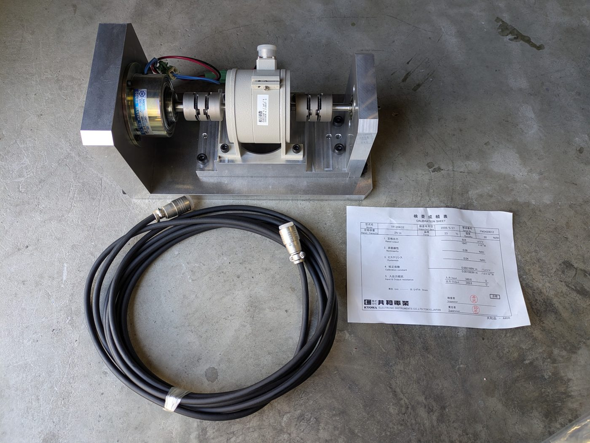
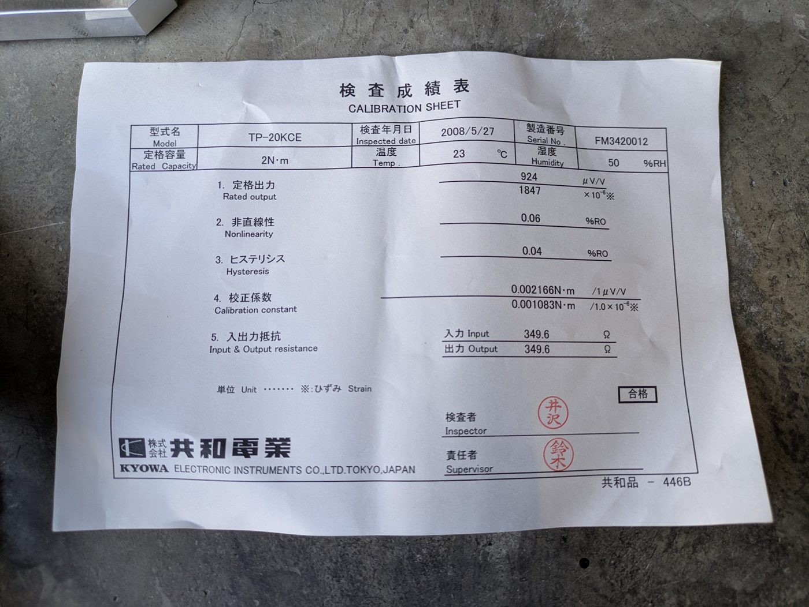
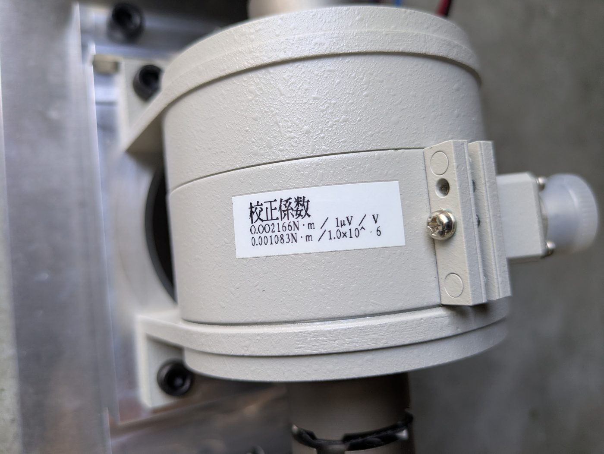
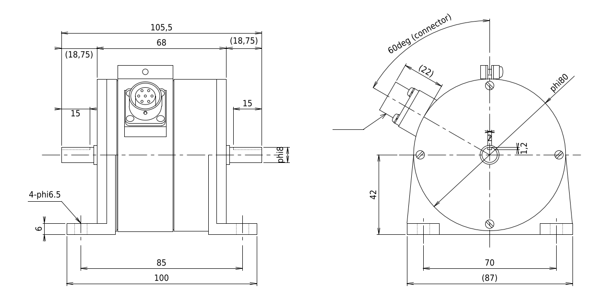
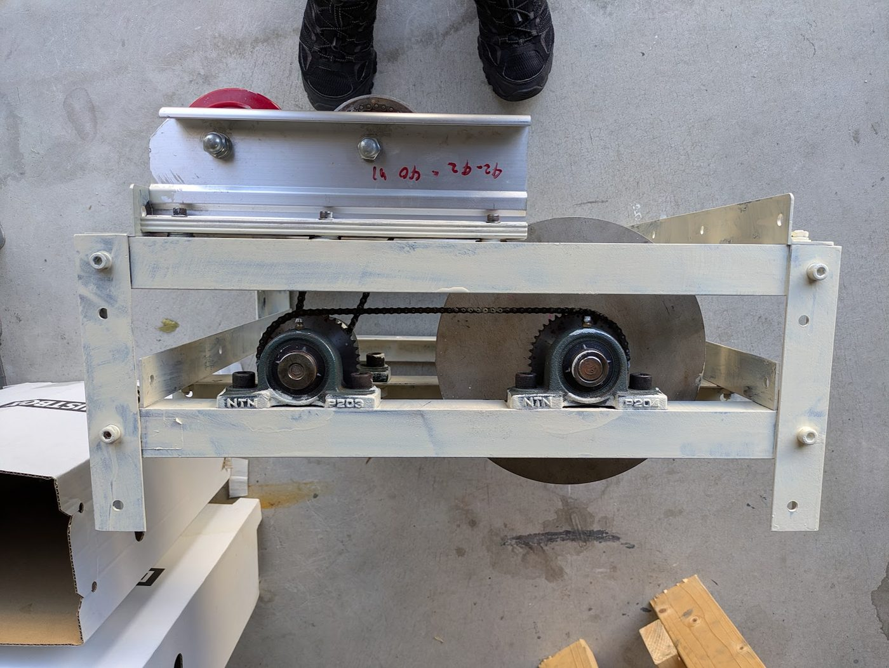
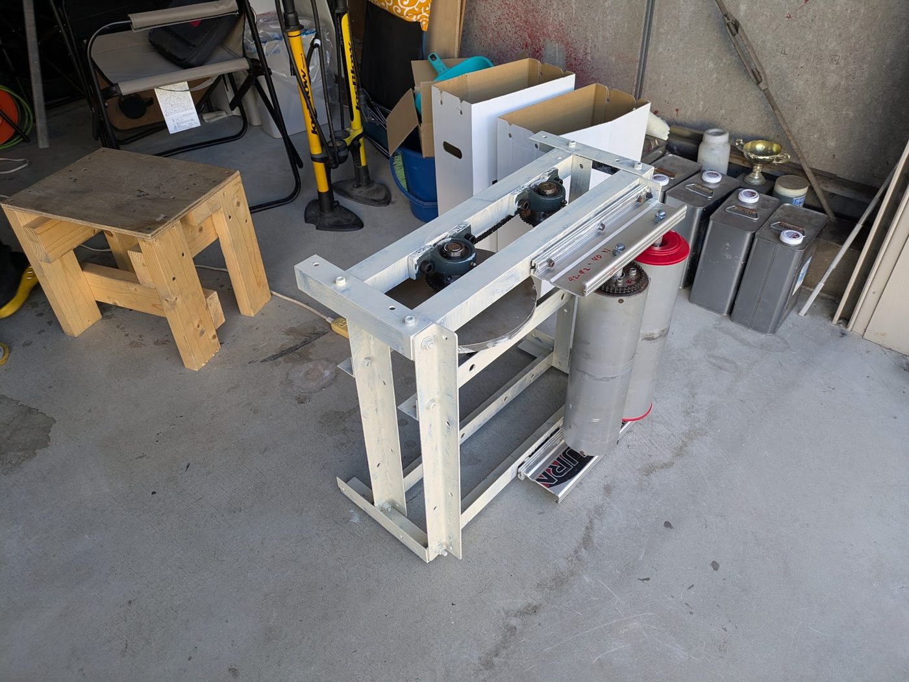
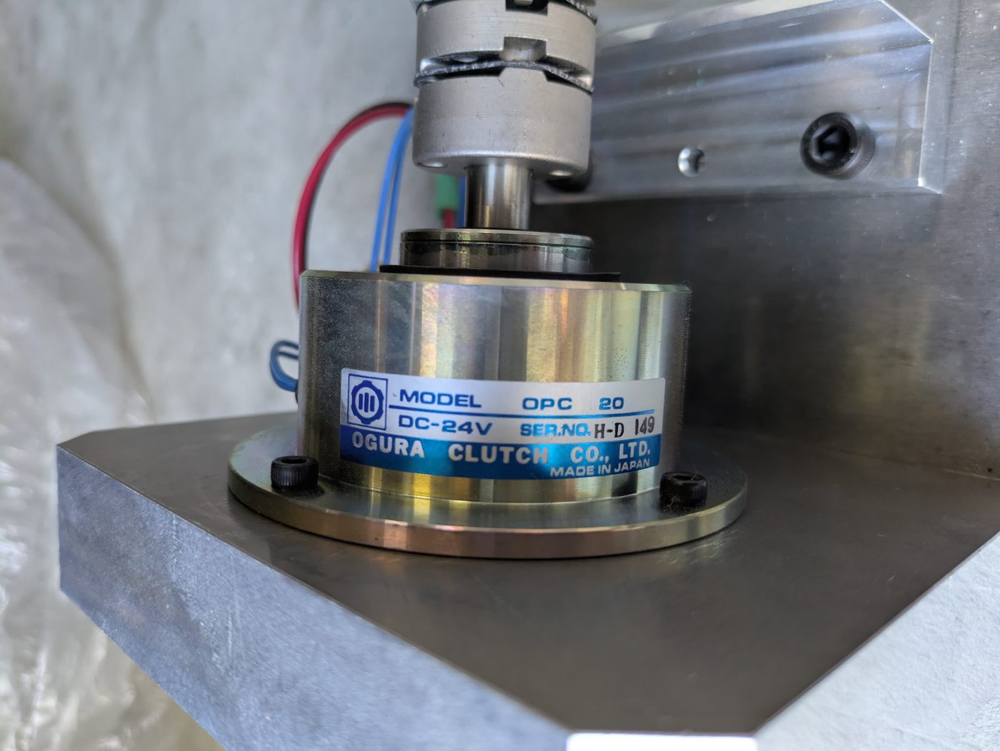

# トルクセンサ 共和電業 TP-20KCE の使用検討

手持ちの共和電業 TP-20KCE（定格 2 N·m）を、負荷装置の力の計測（要件 R-S-02）に使う方法を検討する。仕様は TP-D/E 型の取扱説明書（[IM-T-142f](vendor/kyowa_tp-e_manual_im-t-142f.pdf)）と外形図（[DXF](vendor/kyowa_tp-e_outline.dxf)）による。

## 結論

- **回さずに反力を測る（反力型）**。負荷装置のモーターを揺動支持し、ハウジングの反トルクを TP-20KCE で台に伝える。センサは回らないので、**最高回転数 4,000 rpm とスリップリングのブラシ寿命（3,000 rpm で 50〜60 時間）の制約がなくなる**。
- 回して使うと、現行のフライホイール軸（40:19）では 37.6 km/h で 4,000 rpm に達し、**鈴鹿 1 周の 38% が上限を超える**。ローラ軸に付ければ 79 km/h まで回せるが、2 N·m ＝ 38 N しか測れない。
- **モーターは現行のフライホイール軸（40:19 = 2.105 倍）に同軸で付ける**のが最も改造が少ない。2 N·m ＝ ローラ表面 80 N、許容過負荷 120%（2.4 N·m）＝ 96 N。鈴鹿 1 周（最大 81 N）は定格の 101% 以内、22〜28 km/h の全開の定速測定（80〜91 N）は 100〜114% で、許容過負荷の範囲に入る。定格を超える範囲の直線性は、分銅で 2.3 N·m まで校正して確かめる。
- それで足りなければ、増速を 2.5 倍にする（2 N·m ＝ 95 N）。モーターは 80 km/h で 10,100 rpm になる。
- **過負荷ストッパーは必須**（2.3 N·m で当てる）。センサの許容過負荷は 120% しかない。
- 精度は十分: 成績書で非直線性 0.06%RO・ヒステリシス 0.04%RO。ローラ表面に換算して ±0.05 N 程度で、要件の ±1 N を大きく上回る。
- 同じ台の小倉クラッチ OPC 20（パウダクラッチ、2 N·m）は、放熱の容量が 2 桁足りず負荷装置には使えない（6 章）。

## 1. 仕様



| 項目 | 値 | 出典 |
| --- | --- | --- |
| 型式・製造番号 | TP-20KCE、FM3420012（2008-05-27 検査） | 成績書 |
| 定格容量 | 2 N·m | 成績書（シリーズは 0.2〜2 N·m） |
| 定格出力 | **924 μV/V**（シリーズの仕様は 0.75〜1.5 mV/V） | 成績書 |
| 非直線性・ヒステリシス | 0.06%RO・0.04%RO（仕様は ±1%RO） | 成績書 |
| 校正係数 | 0.002166 N·m / (1 μV/V) | 成績書 |
| 最高回転速度 | **4,000 rpm** | 取扱説明書 |
| 許容過負荷 | **120%**（2.4 N·m） | 取扱説明書 |
| 推奨印加電圧 | **1〜4 V**（AC または DC） | 取扱説明書 |
| 入出力抵抗 | 350 Ω ±0.5%（成績書 349.6 Ω） | |
| 零点・出力の温度影響 | ±0.03%RO/°C・±0.03%/°C（補償範囲 0〜60 °C） | 取扱説明書 |
| 回転によるノイズ | 12 × 10⁻⁶ ひずみ p-p 以下（回すときのみ） | 取扱説明書 |
| ねじれ角・ねじればね定数 | 0.013 rad（定格時）、153.8 N·m/rad | 取扱説明書 表 1 |
| 慣性モーメント | 81 g·cm² | 取扱説明書 表 1 |
| 信号の伝達 | スリップリングとブラシ。ブラシは 3,000 rpm で 50〜60 時間使うと摩耗粉で絶縁が下がる（摩耗は回転数に比例） | 取扱説明書 5 章 |
| 質量 | 約 560 g（ケーブルを除く） | |
| ケーブル | 0.3 mm² 4 心シールド、5 m、両端コネクタ | |
| 配線 | A 赤（入力 +）、B 白（出力 −）、C 黒（入力 −）、D 緑（出力 +）、E シールド（本体ケース）、F・G 空き | 取扱説明書 図 7 |

 

### 外形（TP-E 型）



| 項目 | 寸法 |
| --- | --- |
| 全長（軸端から軸端） | 105.5 mm（本体 68 mm、軸の突き出し 15 mm × 2） |
| 軸 | φ8、キー溝 幅 2 × 深さ 1.2 |
| 本体 | φ80、コネクタは真上から 60° の向き |
| 軸の高さ | 取付面から 42 mm |
| 取付脚 | 100 × 87 mm、取付穴 4-φ6.5、ピッチ 85 × 70 mm、厚さ 6 mm |
| カップリング（オプション） | FC-2B（ダブル、φ36、穴 φ8 G7、ねじればね定数 約 800 N·m/rad、偏角 0.8°、偏心 0.5 mm）、FC-1B（シングル） |

取扱説明書の注意（設計に関わるもの）:

- 脚で取り付けるときは、**両側をダブルのフレキシブルカップリング（FC-2B）**でつなぐ。固定軸継手は不可（心出しが難しく、軸受に大きな荷重がかかる）。
- 容量が小さいので、軸を手でねじったり曲げたり、工具で衝撃を与えたりしない（永久変形する）。
- 負荷をかけたまま急に始動すると過負荷になり、軸が折れることがある。
- 回して使うときは、測る回転数で無負荷のまま回してゼロ点を合わせる（風圧と遠心力でゼロ点が動く）。
- 防水・防滴ではない。

## 2. 現行ダイナモの駆動系

 

| 項目 | 内容 |
| --- | --- |
| ローラ | ミノウラの自転車用ローラ台のローラ φ105 × 2 本。駆動輪を 2 本で受け、1 本はフリー、もう 1 本からチェーンでフライホイールへ |
| チェーン | 2 段。スプロケットは 19・40・42・42 歯で、19:40 と 42:42 にチェーンを掛け、40 と 42 は中間軸で同軸固定 |
| 増速比 | **40:19 = 2.105 倍**（ローラ 1 回転でフライホイール 2.105 回転）として扱う |
| 軸受 | NTN のピロー型 P203・P204 |

**増速比の確認が要る**: 19 歯がローラ側で 19:40 に掛かると、全体では 19/40 × 42/42 = 0.475 倍の**減速**になり、「40:19 で約 2 倍に増速」と合わない。回転マス 105 kg 相当（φ105 ローラで 0.289 kg·m²）は、2.105 倍の増速なら φ300 × t10.5 mm の鋼板で説明でき、0.475 倍の減速なら φ300 × t205 mm が必要で写真と合わない。そこで**全体の増速比は 2.105 倍**とした（フライホイール側が 19 歯と考えられる）。

**損失の内訳の候補**: LOG0650 の惰行で 30 km/h 44 N（実走の約 10 倍）。タイヤとローラの接触が 2 か所（フリーのローラも含む）、チェーン 2 段、軸受（ローラ 2 本・中間軸・フライホイール軸）、φ300 のフライホイールの風損が考えられる。車両を載せずにフライホイールを回して惰行させれば、タイヤ以外の損失を分けて測れる。

## 3. 容量と回転数の関係

負荷装置の軸の増速比を n、ローラ半径を r（52.5 mm）とすると、

```
センサのトルク   T = F · r / n            （F: ローラ表面の力）
軸の回転数       N = v / r · n · 60/2π     （v: 車速）
```

r を消すと **T·ω = F·v**。2 N·m のセンサで「100 N を 80 km/h まで」測るには、ローラ径によらず 10,600 rpm まで回る軸に付ける必要がある（回して使う場合）。

| 取付軸 | 増速比 n | 2 N·m ＝ | 2.4 N·m（許容過負荷）＝ | 81 N（鈴鹿の最大） | 91 N（全開の定速、22 km/h） | 4,000 rpm になる車速 | 80 km/h の回転数 |
| --- | --- | --- | --- | --- | --- | --- | --- |
| ローラ軸 | 1 | 38 N | 46 N | 4.25 N·m | 4.78 N·m | 79 km/h | 4,042 rpm |
| **フライホイール軸（現行）** | **2.105** | **80 N** | **96 N** | **2.02 N·m（101%）** | **2.28 N·m（114%）** | 37.6 km/h | 8,510 rpm |
| 増速 2.5 倍（新設） | 2.5 | 95 N | 114 N | 1.70 N·m（85%） | 1.91 N·m（96%） | 31.7 km/h | 10,105 rpm |

- 鈴鹿 1 周の指令（[解析ノート 4 章](analysis_notes.md#4-燃費優先の走り方での-1-周と負荷プロファイル)）をフライホイール軸で換算すると −1.35〜+2.02 N·m。2 N·m を超えるのは 1 周の 1.2%（ダンロップの登り）。
- 全開の定速測定（実走推定の出力カーブ）をフライホイール軸で換算すると、2,625 rpm（21.8 km/h）で 2.28 N·m、3,375 rpm（28.0 km/h）で 2.00 N·m。**EFI のマップ合わせで使う回転域の下側が、定格の 100〜114% になる**（許容過負荷 120% 以内）。
- 坂道発進の試験では、負荷装置が受け持つのは勾配の力（7.5% で 78 N ＝ 1.96 N·m）だけ。エンジンの駆動力（約 130 N）の残りはフライホイールの加速に使われ、センサには来ない。

## 4. 取付方法

| 方法 | 測る量 | 長所 | 短所 | 判定 |
| --- | --- | --- | --- | --- |
| A. 回転軸に直列（写真の台と同じ使い方） | 負荷装置の軸トルク | 構成が簡単 | フライホイール軸では 37.6 km/h で 4,000 rpm を超える（鈴鹿 1 周の 38%）。ブラシの寿命（3,000 rpm で 50〜60 時間）。回転でゼロ点が動く | 加速域（18〜36 km/h）の定速試験だけなら可 |
| **B. 反力型（回さない）** | 負荷装置のモーターの電磁トルク＋モーター内部の軸受摩擦・風損 | 回転数・ブラシの制約がない。回転のノイズもない。静止状態で分銅で校正できる | 揺動支持の軸受の摩擦が誤差になる。取付の工作が要る | **推奨** |
| C. ローラ軸に直列 | 車輪の駆動力からローラの損失を引いた値（慣性分を含む） | エンジンの出力を直接見られる | 2 N·m ＝ 38 N しか測れない | 不可 |

### 反力型（B）の構成

```
 ローラ ─チェーン 2 段（2.105 倍）─ フライホイール軸 ═ カップリング ═ モーター軸
                                                                        │
                                                    モーター（ハウジングは玉軸受 2 個で揺動支持）
                                                                        │ ハウジングの端面のフランジ
                                                                   FC-2B（ダブル）
                                                                        │
                                                       TP-20KCE（取付脚で台に固定。軸は回らない）
                                                                        │
                                                                   FC-2B（ダブル）
                                                                        │
                                                                   台に固定した軸
     ハウジングのアーム ── 過負荷ストッパー（±2.3 N·m で当たる。すき間を調整ねじで合わせる）
```

- 取扱説明書のとおり、センサの両側を FC-2B でつなぎ、センサに曲げとスラストがかからないようにする。センサの脚（4-φ6.5、ピッチ 85 × 70）は台に固定する。
- **過負荷ストッパー**: センサ（153.8 N·m/rad）とカップリング 2 個（各 800 N·m/rad）を合わせたねじればね定数は約 111 N·m/rad。2.3 N·m でのねじれは 0.021 rad（1.2°）で、半径 60 mm のアームの先で約 1.2 mm 動く。このすき間で当たるストッパーを、調整ねじで両方向に付ける。当たっている間は値が飽和するので、制御器はそれを検出して止める（R-F-04）。
- **揺動支持の軸受**: 摩擦がそのまま誤差になる。シールなしか非接触シールの玉軸受にし、校正（5 章）で不感帯を確かめる。
- **共振**: ハウジングの慣性 J とねじればね定数 111 N·m/rad で固有振動数が決まる（J = 0.003 kg·m² なら約 31 Hz、0.006 なら約 22 Hz）。単気筒の爆発周期（2,200〜4,300 rpm で 18〜36 Hz）と重なりうる。反力として出るのはモーターの電磁トルクなので、電流制御が滑らかなら大きくは励振されないが、組んだあとに打撃試験で固有振動数を測り、センサの値は 5〜10 Hz の低域フィルタを通して使う。力の制御の帯域（R-C-03）は固有振動数より十分低くする。
- **熱**: モーターの熱がセンサに伝わらないよう、ハウジング側のカップリングとの間に断熱材を入れる。零点の温度影響は ±0.03%RO/°C（10 °C で 0.006 N·m ＝ ローラ表面 0.24 N）。試験の前後にモーターを止めてゼロ点を取る。

### モーターへの影響（フライホイール軸に同軸で付ける場合）

| 項目 | 値 |
| --- | --- |
| 最高回転数 | 8,510 rpm（80 km/h）→ **9,000 rpm 以上**（雨の 55 km/h までなら 5,850 rpm） |
| ピークトルク | 2.3 N·m（ストッパーの値）。連続はその半分程度 |
| 吸収のピークパワー | 約 0.86 kW（69 km/h の登り、1.11 N·m × 7,350 rpm） |
| 慣性 | モーターの回転子の慣性は 2.105² 倍で回転マスに加わる。フライホイールを削って合わせる（R-V-04） |

## 5. 計測回路と校正

| 項目 | 値 |
| --- | --- |
| 印加電圧 | **1〜4 V**（推奨範囲）。3.3 V なら 2 N·m で 3.05 mV |
| 分解能の目安 | ローラ表面 1 N ＝ 0.025 N·m（n = 2.105）＝ 11.5 μV/V ＝ 38 μV（3.3 V 印加） |
| AD 変換 | 24 bit のブリッジ用 AD（ADS1220・ADS1256 など）を、印加電圧を基準電圧にしたレシオメトリック接続で。1 kSPS 以上。**HX711（最大 80 SPS）は不可** |
| あるいは | 動ひずみアンプ（アナログ出力）→ 制御器の AD。共和電業のアンプなら 1 × 10⁻⁶ ひずみ ＝ 0.001083 N·m で換算 |
| 換算 | T [N·m] = 0.002166 × 出力 [μV/V]。符号は取扱説明書 3.8 の感度方向 |
| 配線 | 付属ケーブル（5 m）をそのまま使う（延長すると感度が下がる。取扱説明書 7.4）。モーターの動力線と離し、シールドは計測器側の 1 点で接地 |

**校正（R-V-01）**: 反力型にすると、センサを付けたまま静止状態で校正できる。

1. ハウジングにアーム（例: 長さ 100 mm）を付け、分銅を吊るす。0.5 / 1.0 / 1.5 / 2.0 / 2.3 kg で 0.49 / 0.98 / 1.47 / 1.96 / 2.26 N·m（2.3 kg は許容過負荷の内側で、定格を超える範囲の直線性を見るため）。
2. 両方向（吸収・力行）で、増やしてから減らす。
3. 成績書の校正係数からのずれ、直線性、ヒステリシス、揺動支持の摩擦による不感帯を確かめる。
4. 30 分ほど通電して、ゼロ点の温度ドリフトを確かめる。

## 6. 小倉クラッチ OPC 20 について



- 定格トルク 2 N·m のマイクロパウダクラッチ（旧型の OPC 型 20 形。生産終了。後継は OPC20N）。
- 電流にほぼ比例し速度によらないトルクを出せるが、**吸収したエネルギーはすべて熱になる**。自然冷却の小型品で、後継の OPC20N の通販表記は「容量 18 W」。
- 鈴鹿 1 周の吸収は平均 196 W・ピーク 858 W、全開の定速測定は 500〜630 W で、**1/10〜1/50 しかない**。負荷装置には使えない。
- 使い道: TP-20KCE の単体の動作確認（写真の台のまま低速で回し、数十 W 以内でトルクをかける）。

## 7. 予算への影響

- 推奨構成のロードセル（131,780 円）とアンプ（約 5 万円）の代わりに、TP-20KCE（保有）と 24 bit AD（数千円）か動ひずみアンプを使う。
- 反力型の取付（揺動支持の軸受 2 個、FC-2B 2 個、アーム、ストッパー）で 1〜2 万円。
- メーカーでの再校正を頼む場合は別途（要見積）。

要件定義の [13 章](requirements.md#13-概算予算) に反映済み。

## 出典

- 共和電業「TP-D/E 型小型トルク変換器 取扱説明書」IM-T-142f（'10.6）: [docs/vendor/kyowa_tp-e_manual_im-t-142f.pdf](vendor/kyowa_tp-e_manual_im-t-142f.pdf)
- 共和電業 TP-E 外形図: [docs/vendor/kyowa_tp-e_outline.dxf](vendor/kyowa_tp-e_outline.dxf)
- 共和電業 トルク変換器の製品一覧: https://product.kyowa-ei.com/en/products/torque-transducers
- 小倉クラッチ OP シリーズ: https://www.oguraclutch.co.jp/product/op/
- OPC20N（アスクル）: https://www.askul.co.jp/p/U356690/
